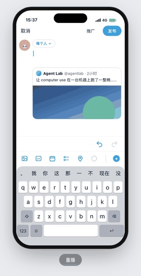

# 推广之手 · x-hands

在 X（Twitter）上发帖时，一只西装手伸出来让你点「推广」——然后另一只手一巴掌把它打飞。

灵感来自 X 手机端发帖时会冒出来、指着「推广」按钮的那只手。

## 安装

- **Chrome 应用商店**：审核中
- **手动安装**：下载或 clone 本仓库，打开 `chrome://extensions`，打开「开发者模式」，点「加载已解压的扩展程序」，选择 `extension/` 文件夹。

## 怎么用

在 x.com 的发帖框里打几个字，停一下，好戏开场。每个发帖框只演一次；想再看，点工具栏上的插件图标。

- 页面是中文时显示「推广 / 啪！」，否则显示「Promote / SLAP!」。
- 系统开启「减少动态效果」时，不再抖动发帖框。

## 隐私

插件不收集、不存储、不发送任何数据，没有申请任何权限，只在 x.com / twitter.com 的页面上叠加一层动画，不会修改或读取你的帖子内容。详见 [PRIVACY.md](PRIVACY.md)。

## 目录

| 路径 | 内容 |
| --- | --- |
| `extension/` | 浏览器插件（Manifest V3） |
| `index.html` | 浏览器里的手机端交互演示，`python3 -m http.server` 后打开 |
| `store/` | Chrome 应用商店的截图、宣传图和文案 |
| `scripts/pack.sh` | 打包成商店上传用的 zip（输出到 `dist/`） |

---

## English

**x-hands** — when you write a post on X, a hand in a suit reaches in and pokes a "Promote" button. Then another hand slaps it away.

Install from source: open `chrome://extensions`, enable Developer mode, click "Load unpacked" and pick the `extension/` folder. The extension collects no data and requests no permissions.

Not affiliated with X Corp.

## License

[MIT](LICENSE)
